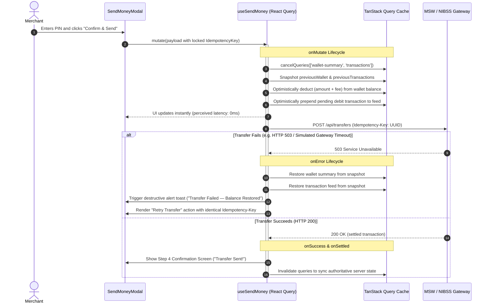

# FirstBank NovaPay — NovaBiz Merchant Dashboard

> Production-grade Nigerian fintech merchant dashboard engineered for MSMEs, featuring sub-second settlement insights, zero floating-point currency drift, deterministic idempotency, 60fps virtualization across low-end mobile devices, and resilient optimistic UI rollback.


-38B2AC?style=for-the-badge&logo=tailwind-css)


---

## 1. Single-Command Quick Start

### Prerequisites
- **Node.js**: v18.0.0 or higher (v20+ recommended)
- **npm**: v9.0.0 or higher

```bash
# Clone the repository
git clone https://github.com/firstbank/novabiz-merchant-dashboard.git
cd novabiz-merchant-dashboard

# Install dependencies and start the local development server
npm install && npm run dev
```

The application will start on `http://localhost:5173`. MSW (Mock Service Worker) automatically activates in the browser to intercept all `/api/*` endpoints with zero external backend dependencies.

### Verification & Testing Commands

| Command | Description | Target |
| :--- | :--- | :--- |
| `npm run dev` | Starts Vite dev server with MSW mock service worker | `http://localhost:5173` |
| `npm test` | Runs 115 Vitest unit and component integration tests | Unit, Store, Hooks, Components |
| `npm run test:watch` | Runs Vitest in interactive watch mode | Development TDD |
| `npx playwright test` | Executes Playwright E2E tests (Desktop & Mobile 360px) | Happy path & Chaos rollback |
| `npm run storybook` | Starts Storybook v8 component development environment | `http://localhost:6006` |
| `npm run build` | Compiles TypeScript (`tsc -b`) and bundles production assets | `dist/` |
| `npm run build-storybook` | Compiles static Storybook documentation bundle | `storybook-static/` |

---

## 2. Component & Design System Architecture (`src/ui/` vs `src/components/`)

The design system enforces strict separation of concerns between headless, accessible UI primitives and domain-specific business features:

```
src/
├── ui/                            # Reusable headless Shadcn UI / Radix primitives
│   ├── button.tsx                 # Focus-ring visible, WCAG AA compliant buttons
│   ├── card.tsx                   # Structural surfaces (Card, Header, Content, Footer)
│   ├── dialog.tsx                 # Radix Dialog with focus trap & Escape handling
│   ├── input.tsx & label.tsx      # Form controls wired for aria-invalid & aria-describedby
│   ├── select.tsx                 # Radix Select primitive with keyboard navigation
│   ├── badge.tsx                  # Semantic status variants (successful, pending, failed, KYC tiers)
│   ├── alert.tsx                  # Semantic alerts (default, destructive, warning, success)
│   ├── skeleton.tsx               # Explicit async loading placeholders
│   ├── switch.tsx & slider.tsx    # Accessible toggle & range controls
│   ├── popover.tsx                # Radix Popover primitive
│   ├── toaster.tsx & use-toast.ts # Live-region toast notifications (aria-live="assertive" / "polite")
├── components/                    # Domain-coupled business views & flows
│   ├── Header.tsx                 # Merchant branding, KYC Tier badge, theme switch, offline banner
│   ├── BalanceSummary.tsx         # Available/Ledger balances, inflow/outflow, screen-reader live updates
│   ├── TransactionFilterBar.tsx   # Search, status/type filters, date-range, active-filter badges
│   ├── VirtualizedTransactionFeed # 1,250+ row virtualized table using react-window (60fps)
│   ├── SendMoneyModal.tsx         # 4-step NIP inter-bank transfer dialog (Recipient -> Amount -> Review -> Success)
│   ├── ChaosSimulatorPanel.tsx    # Evaluator chaos simulator floating drawer
│   └── NetworkChaosDialog.tsx     # Header-triggered network chaos modal
├── types/                         # Branded domain types (Kobo, Transaction, WalletSummary, KYC)
├── store/                         # Zustand stores (useAppStore: theme, filters, chaos state)
├── hooks/                         # React Query hooks (useDashboardData, useSendMoney)
└── utils/                         # Zero-drift currency math & XSS sanitization
```

### Key Architectural Decisions:
1. **Accessibility by Default (WCAG 2.1 AA)**:
   - All interactive controls in `src/ui/` provide distinct focus rings (`focus-visible:ring-2 focus-visible:ring-brand-500 focus-visible:ring-offset-2`).
   - Modal dialogs enforce strict focus trapping, return focus to the trigger element on close, and dismiss on `Escape`.
   - Dynamic form validation binds `aria-invalid="true"` directly to inputs alongside `aria-describedby` error announcements.
2. **Mobile-First Responsiveness (360px–1440px)**:
   - Designed to run smoothly on small screens (e.g., 360px width common on budget Android devices used by Nigerian traders).
   - Layout scales fluidly to split-pane desktop views (1440px) without horizontal scrolling or layout shift.
3. **Persisted Dark Mode (`darkMode: 'class'`)**:
   - Implemented via Tailwind semantic CSS variables (`background`, `foreground`, `border`, `brand-*`, `fbgreen-*`).
   - Theme preference is persisted in `localStorage` via Zustand middleware and avoids Flash of Unstyled Theme (FOUT).

---

## 3. State & Data-Fetching Architecture

The application bifurcates state into **Server State** (TanStack Query v5) and **Client State** (Zustand):

```
┌────────────────────────────────────────────────────────┐
│                      Client State                      │
│                        (Zustand)                       │
│  - Theme: 'light' | 'dark' (persisted in localStorage) │
│  - Active Transaction Filters: status, type, date, q   │
│  - Network Chaos Simulator: latency, failure rate, fail│
└────────────────────────────────────────────────────────┘
                            │
                            ▼
┌────────────────────────────────────────────────────────┐
│                      Server State                      │
│                  (TanStack Query v5)                   │
│  - ['wallet-summary']: Merchant balance & KYC limits   │
│  - ['transactions', filters]: 1,250+ row ledger feed   │
│  - ['banks-list']: Nigerian commercial bank directory  │
│  - ['bank-resolve', account, code]: NIP name inquiry   │
└────────────────────────────────────────────────────────┘
```

### Optimistic Mutation & Rollback Cycle (`useSendMoney`)

When initiating a funds transfer, the system prioritizes perceived performance while maintaining absolute ledger integrity:



1. **Exponential Backoff**: Transient network and 5xx errors automatically retry up to 3 times with exponential backoff (`Math.min(1000 * 2 ** attempt, 8000)`), accommodating unstable cell towers. 4xx validation errors fail fast without retry.
2. **Snapshot Restoration**: If a mutation fails or times out, the snapshot captured in `onMutate` is restored synchronously in `onError`. The balance and feed roll back without needing a page refresh.

---

## 4. Kobo Integer Invariant & Security Architecture

### Zero Floating-Point Drift (The Kobo Invariant)

Floating-point arithmetic in JavaScript (`Number`) suffers from IEEE 754 precision issues (e.g., `19.99 * 100 === 1998.9999999999998`). In banking applications, rounding or truncation errors accumulate, creating balance discrepancies and regulatory audit failures.

**The NovaPay Solution**:
- All internal balances, transaction amounts, and fees are stored strictly as integer **kobo** (`type Kobo = number`, where `100 kobo = ₦1.00`).
- User input is parsed using string-split arithmetic with `BigInt`:

```typescript
// src/utils/currency.ts
export function parseNairaInputToKobo(input: string): Kobo {
  const clean = input.replace(/[^\d.]/g, '')
  const [nairaPart, rawFraction = ''] = clean.split('.')
  const paddedFraction = rawFraction.padEnd(2, '0').slice(0, 2)
  const totalKobo = BigInt(nairaPart || '0') * 100n + BigInt(paddedFraction)
  return Number(totalKobo) as Kobo
}
```

- Amounts are formatted for display strictly via `Intl.NumberFormat`:

```typescript
export function formatKoboToNaira(kobo: number): string {
  if (!Number.isSafeInteger(kobo)) throw new TypeError('Expected safe integer kobo')
  return new Intl.NumberFormat('en-NG', {
    style: 'currency',
    currency: 'NGN',
    minimumFractionDigits: 2,
    maximumFractionDigits: 2,
  }).format(kobo / 100)
}
```

### Deterministic Idempotency

On flaky 2G/3G networks, a request timeout does not guarantee that the upstream banking switch did not execute the debit. To prevent double debits:
1. An `Idempotency-Key` (cryptographic UUID) is generated and locked when the merchant advances from Step 2 to Step 3 (**Review Transfer**).
2. The key is attached to the `Idempotency-Key` HTTP header.
3. If the network drops and the user or React Query retries, the **exact same key** is re-submitted.
4. The MSW backend records processed keys in an in-memory map; repeated requests return the original response without executing a second debit.

### Untrusted Input & XSS Protection

Merchant transaction narrations and counterparty names are treated as untrusted input:
- Stripped of ASCII control characters (`[\x00-\x1F\x7F]`) and capped at 100 characters.
- Rendered exclusively through React JSX text bindings (never using `dangerouslySetInnerHTML`).
- Automated integration tests in `TransactionFeed.test.tsx` verify that XSS payloads (`<script>`, ``) are rendered harmlessly as escaped text.

---

## 5. Key Trade-offs & Nigerian Operating Context

### 1. Mock Service Worker (MSW v2) vs Real NIP Webhooks
- **Trade-off**: Evaluator assessments require a self-contained environment runnable with a single command without external cloud dependencies.
- **Implementation**: MSW v2 intercepts browser and Node requests, seeding 1,250 realistic Nigerian transactions (FirstBank, GTBank, Zenith, Access, OPay, Moniepoint) with simulated NIBSS NIP resolution delays (350ms–950ms).

### 2. Virtualization with Fixed Row Heights (`react-window`)
- **Trade-off**: Dynamic row heights require DOM measurement passes that cause frame drops during fast scrolling on lower-end devices.
- **Implementation**: Fixed row heights (`ROW_HEIGHT = 96px`) ensure consistent 60fps scrolling performance, zero layout shift (CLS), and negligible memory overhead even with thousands of transactions.

### 3. Low-Connectivity & USSD Fallback (`*894#`)
- **Context**: Mobile internet connectivity in Nigerian markets often drops to EDGE or experiences high packet loss.
- **Implementation**: When offline mode is detected or transfer requests fail, a persistent high-contrast banner surfaces FirstBank's official USSD code:
  > *"Poor connectivity detected. Retrying automatically... For urgent transfers without data, dial \*894#."*

### 4. Regulatory Awareness (CBN & NDPA 2023)
- **Central Bank of Nigeria (CBN) KYC Tiers**: The dashboard displays the merchant's KYC status (`Tier 2`) and enforces daily transfer limits (e.g., ₦300,000.00/day), providing warnings when transactions exceed limits.
- **Nigeria Data Protection Act (NDPA 2023)**: Verified recipient bank account lookups include clear data protection indicators, NDIC insurance badges, and compliance notices.

---

## 6. Project Structure

```
.
├── .storybook/              # Storybook configuration & preview decorators
├── e2e/                     # Playwright end-to-end test specs
│   └── send-money.spec.ts   # Happy path & Chaos rollback E2E scenarios
├── src/
│   ├── __tests__/           # Vitest integration tests (Currency, Feed, SendMoney)
│   ├── components/          # Domain components (Header, Balance, Feed, Modal)
│   ├── hooks/               # TanStack Query custom hooks
│   ├── lib/                 # API client, chaos interceptors, QueryClient config
│   ├── mocks/               # MSW v2 handlers, seed data, and in-memory DB
│   ├── store/               # Zustand application store
│   ├── stories/             # Storybook stories for UI primitives and views
│   ├── types/               # TypeScript domain models and branded types
│   ├── ui/                  # Shadcn UI / Radix primitives
│   └── utils/               # Currency math, sanitization, and formatting
├── playwright.config.ts     # Playwright configuration (Chromium & Mobile 360px)
├── tailwind.config.js       # Tailwind CSS theme, colors, and animations
├── tsconfig.json            # Strict TypeScript configuration
└── vite.config.ts           # Vite build config with path aliases (@/ -> src/)
```

---

## 7. License & Compliance
Licensed under the MIT License. Developed for the **FirstBank Digital Factory Assessment**. Compliant with CBN regulations and NDPA 2023 guidelines.
